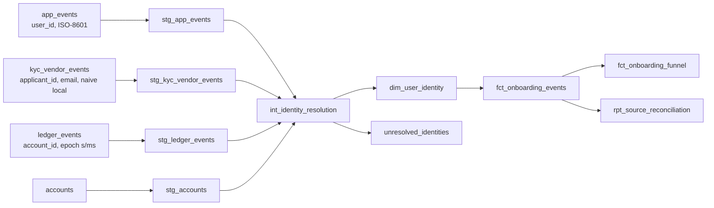

# Onboarding funnel data model

Sign-up → Email verification → Identity verification → First deposit → First trade, modeled from three
inconsistent sources into one funnel table a PM can query without caveats in their head.

```bash
python -m venv .venv && .venv/Scripts/activate   # macOS/Linux: source .venv/bin/activate
pip install -r requirements.txt                  # duckdb only
python run.py                                    # generate → build → test → scorecard → analysis
```

`run.py` exits 1 if any error-severity test fails (the build is blocked) and 2 if the scorecard below doesn't
match. Output: `warehouse.duckdb` (query with the DuckDB CLI or Python) and [analysis/results.md](analysis/results.md).

## 1. TL;DR

- **Two marts.** `fct_onboarding_events` (long, one row per user × step × attempt) is the auditable
  record. `fct_onboarding_funnel` (wide, one row per user) is what the PM queries.
- **One anchor.** Every identifier resolves to a `user_key` derived from the sign-up `user_id`. Matching is
  deterministic only. Anything that doesn't match goes to `unresolved_identities`, never dropped.
- **Flag, don't fix.** Raw timestamps are kept. Gaps, disorder and immaturity become columns
  (`is_inferred_*`, `is_sequence_valid`, `is_cohort_mature_*`), so analysts decide how to treat them.
- **Strict and raw flags side by side.** `reached_<step>` requires every earlier step. `has_<step>_event`
  doesn't. During the injected tracker outage, the two disagree by 7 points.
- **Proven against injected mess.** The generator records what it broke. The tests and models detect
  **18/18** of those issues at the exact injected counts (scorecard in `run.py` step 4).



Layout follows dbt conventions (`models/`, `tests/`, `analysis/`, `{{ var }}` substitution) without the
dependency. Run-time settings are in `VARS` at the top of `run.py`.

## 2. Grain and keys

| Table | Grain | Key |
|---|---|---|
| `dim_user_identity` | (source_system, source_id) | → `user_key` |
| `fct_onboarding_events` | user × step × attempt | (`user_key`, `step_name`, `attempt_number`); also unique on (`source_system`, `source_event_id`) |
| `fct_onboarding_funnel` | user | `user_key` |

- **`user_key = md5('app_events|' || user_id)`**: a deterministic hash, so it's stable across full
  rebuilds and doesn't depend on load order. *Rejected:* exposing `user_id` directly, because it ties
  every downstream query to one source's ID type, and the source prefix leaves room for a second anchor
  later (e.g. a mobile-only sign-up service). *Rejected:* a sequence, because keys would change on rebuild.
- **The sign-up `user_id` is the anchor** because sign-up is the funnel's denominator and the one step
  every user must have. A KYC applicant or ledger account without a sign-up can't be placed in a cohort,
  so it becomes an unresolved identity rather than a user.
- **A deposit attempt is a transfer**, not a status row: `initiated → settled → returned` rows collapse to
  one attempt with an `outcome`.

## 3. Identity resolution

[int_identity_resolution.sql](models/identity/int_identity_resolution.sql) tries rules in confidence order.
The first rule that yields **exactly one** user wins.

| Rank | Rule | Applies to | Matched |
|---|---|---|---|
| 1 | `exact_id`: the sign-up `user_id` itself | app_events | 5,000 |
| 2 | `vendor_reference`: KYC `external_ref` = our `user_id` | kyc | 2,784 applicants |
| 2 | `account_mapping`: `ledger.account_id → accounts.user_id` | ledger | 1,874 accounts |
| 3 | `normalized_email`: `lower(trim(email))` matches exactly one sign-up | kyc | 272 applicants |

The 124 unmatched identifiers (148 rows) go to `unresolved_identities` with a reason:
`no_match` (112), `ambiguous_email` (8: one email shared by two sign-ups), and
`account_user_not_signed_up` (4). Emails are kept there for investigation. That table and
`dim_user_identity` are the only places PII lives, and a test enforces that the marts contain none.

**Why no fuzzy matching.** A wrong KYC match attaches one person's verified identity to another person's
brokerage account. That is a compliance error, and it also inflates conversion. A missed match costs one
row in a review queue. With costs that lopsided, the matcher should only accept certain matches. The
cost of that choice is visible: the KYC match rate is 96.2%, below the 98% warning threshold, and the
warning fires.

## 4. Timestamps

Every source timestamp becomes a UTC `TIMESTAMP` (`occurred_at`), with the original kept as text
(`occurred_at_raw`). `ingested_at` comes from the load time.

| Source | Raw format | Rule |
|---|---|---|
| app_events | ISO-8601, mixed offsets (`Z`, `-04:00`, `+05:30`) | parse as an instant, convert to UTC |
| kyc_vendor_events | naive `YYYY-MM-DD HH:MM:SS` | **assume America/New_York**, convert to UTC |
| ledger_events | epoch, seconds *or* milliseconds | `>= 1e11` ⇒ ms (1e11 s is year 5138; 1e11 ms is 1973) |

**Assumptions, stated:**
1. **The KYC vendor console is set to US Eastern.** This can't be proven from the data alone, so
   [analysis 05](analysis/05_timezone_assumption_check.sql) tests it. Read as Eastern, 0 of 2,681 users
   verify their ID before their email. Read as UTC, 1,706 do. Confirming this with the vendor is the
   first open item.
2. **The plausible window is [launch 2026-06-01, as-of].** Rows outside it (6 injected: clock-skewed
   devices and vendor `1970-01-01` defaults) stay in the events table, flagged `is_timestamp_plausible =
   false`, and are excluded from the funnel.
3. **"Now" is pinned** (`as_of = 2026-10-01`) so every run is reproducible. In production it would be
   `current_timestamp`.
4. **"Late-arriving" means ingested more than 72h after the event occurred** (`is_late_arriving`; 308 rows,
   matching the generator).

## 5. Missing and out-of-order events

| Situation | How it's represented | Example (this data) |
|---|---|---|
| Later step present, earlier step has **no event at all** | `is_inferred_<step> = true`. Raw flag stays false, strict flag stays false. | 24 users missing email verification, 77 missing ID verification |
| Earlier step **attempted and failed** | Not inferred. Visible in `id_verification_attempts` and `has_returned_deposit`. | 67 users whose only deposits were returned |
| Steps in the wrong order | `is_sequence_valid = false`, `first_out_of_order_step`. Timestamps untouched. | 61 users (60: vendor reports the *latest review* time, after funding) |
| Signed up recently | `is_cohort_mature_<step> = false`. Filter on it so recent sign-ups don't count as drop-offs. | 97 of 102 users with a pending next step are excluded |

- **Strict vs. raw.** Use `reached_<step>` for the headline funnel, because every rate is then a
  proper subset of the previous step. Use `has_<step>_event` and `is_inferred_*` to diagnose tracking.
  [Analysis 04](analysis/04_strict_vs_raw_by_cohort.sql) shows why both matter. In the week of the
  email-tracker outage (2026-08-17), strict ID verification drops to 47.5% while raw stays at 54.8%,
  in line with every other week. Strict alone would report a fake 7-point product regression.
- **Why flag, not fix.** Clamping a timestamp or backfilling a missing step invents data. It also hides
  the source bug that needs fixing. Out-of-order users still count as converted, because the `reached_`
  flags measure completion, not order.
- **Maturity windows** (3/7/14/30 days to email/ID/deposit/trade) are at least 2.5× the p90 time from
  sign-up to each step, which [analysis 02](analysis/02_time_between_steps.sql) computes. The windows
  are vars, not constants.

## 6. Data quality

Each test is a SQL query that returns failing rows. **Error** tests block the build. **Warn** tests
alert and have a threshold.

| Check | Severity | Protects against | Result on this data |
|---|---|---|---|
| `user_key` unique in funnel | error | COUNT(*) ≠ user count | pass |
| events grain unique (user×step×attempt, and source event) | error | double-counted attempts | pass |
| `signed_up_at` not null | error | users without a cohort / denominator | pass |
| referential integrity, events & funnel → identity | error | orphan users | pass |
| funnel timestamps within [launch, as-of] | error | future dates in a PM dashboard | pass |
| no PII columns in marts | error | emails leaking into widely shared tables | pass |
| reconciliation: raw = duplicates + staged; staged = modeled + unresolved | error | silent drops | pass (0 unaccounted) |
| identity match rate ≥ 98% per source | warn | integration change that stops attributing | **KYC 96.2%** (112 injected no-match) |
| event timestamps in range | warn | clock skew / vendor defaults | **6 rows** (= injected) |
| out-of-sequence rate ≤ 2% | warn | timezone or parsing regression | pass (1.2%) |
| freshness vs. per-source SLA (e.g. KYC 24h) | warn | stalled feed read as non-conversion | **KYC 30.1h** (= injected) |
| daily volume per step < mean − 3σ of trailing 14d | warn | broken tracker read as a conversion drop | **2026-08-19 email, z = −7.2** (= injected outage); 2026-09-30 KYC, z = −3.7 (the stale feed, seen from the other side) |

**Out-of-sequence is a warning, not an error.** Some disorder is legitimate (vendor re-review timestamps,
device clocks). Blocking the PM's table over a known, benign 1.2% would teach people to ignore the
check. The threshold exists to catch a *jump*: the UTC misreading in §4 would push the rate to about
34% and trip it.

**The volume check is one-sided.** Drops are what fake a conversion decline. Spikes (double-firing) are
already caught by dedup and the grain tests. A two-sided rule produced 7 false positives on ordinary
daily noise.

Reconciliation, from `rpt_source_reconciliation`:

| source | raw | duplicates | staged | modeled | unresolved | unaccounted |
|---|---|---|---|---|---|---|
| app_events | 9,550 | 187 | 9,363 | 9,363 | 0 | 0 |
| kyc_vendor_events | 3,766 | 109 | 3,657 | 3,521 | 136 | 0 |
| ledger_events | 6,905 | 81 | 6,824 | 6,812 | 12 | 0 |

## 7. What the PM gets

Full output is in [analysis/results.md](analysis/results.md). The data is synthetic, so these numbers
show what the model makes visible, not real findings.

- **Mature funnel, strict** (sign-ups ≥ 30 days old): 100 → 81.1% email → 54.4% ID → 34.8% deposit → 24.9%
  trade. The naive all-cohort version understates trade conversion by 1.3 points.
- **Median time between steps:** 0.3h to email, 2.1h to ID, 19.5h to deposit, 34.9h to trade.
- **KYC retries:** 12% of applicants need more than one attempt. Deposit conversion among verified users
  falls from 66% (first try) to 47.5% (2 tries) to 30.6% (3+).

## 8. Tradeoffs and next steps with real data

- **Incremental builds.** Rebuild a trailing window of at least the p99 ingestion lag (KYC is the
  laggiest source) and merge on `(source_system, source_event_id)`. Full rebuilds are fine at 5k users.
- **SCD2 on identity mappings.** Today an applicant matched next week silently rewrites history. Add
  `valid_from`/`valid_to` to `dim_user_identity` so a funnel can be reproduced as it was reported.
- **A data contract with source teams.** The KYC vendor always sends `external_ref` and tz-aware
  timestamps, and the ledger uses one epoch unit. Most of the staging layer exists to absorb their absence.
- **Day-of-week seasonality** in the volume check. A trailing 14-day window is fine for a steady
  synthetic stream but will misfire around weekends and marketing launches.
- **Channel / campaign attribution** as a dimension on the funnel. That is the Growth PM's next question.
- **A metric layer** (e.g. dbt Semantic Layer) so "conversion" is defined once, not in every query.
- **Real dbt.** The DAG in `run.py` is maintained by hand. `ref()` would infer it.

**Portability.** SQL is ANSI-leaning. DuckDB-specific spots are commented inline with the
Snowflake/BigQuery equivalents: `AT TIME ZONE` (`CONVERT_TIMEZONE` / `DATETIME(TIMESTAMP(ts, tz))`),
`to_timestamp` (`TO_TIMESTAMP_NTZ(v, 0|3)` / `TIMESTAMP_SECONDS|MILLIS`), `date_diff`, `generate_series`,
`string_agg` (`LISTAGG`), and `try_cast` (`SAFE_CAST` in BigQuery). `GREATEST` is NULL-guarded because
Snowflake and BigQuery return NULL on any NULL argument. `date_trunc('week')` is Monday in DuckDB. In
BigQuery use `ISOWEEK`; in Snowflake check `WEEK_START`.

## 9. Open questions for the PM

1. **Is a returned deposit a deposit?** Currently no: first deposit = the *initiation* time of the
   earliest transfer that **settled and was not returned**. 67 users are excluded as a result.
2. **Deposit timing: initiated or settled?** Initiation measures user intent. Settlement adds bank latency
   to every time-to-deposit metric.
3. **Should inferred steps count?** The headline funnel says no (strict). If the PM trusts that a
   deposit implies KYC passed, `reached_ OR is_inferred_` is a one-line change.
4. **Is a trade a *filled* trade?** And is there a minimum deposit amount that counts as "funded"?
5. **Same email, two sign-ups:** two users or one? Currently two, and their KYC stays unresolved.
6. **Are the maturity windows (3/7/14/30 days) acceptable?** Shorter windows give faster reads but
   more "not yet" users miscounted as drop-offs.
7. **Cohort weeks are in UTC.** Should they use the user's local time or US Eastern instead?

## Appendix: `fct_onboarding_funnel` column dictionary

One row per user with a sign-up `user_id`. No PII. Only events with plausible timestamps count.

| Column | Type | Definition |
|---|---|---|
| `user_key` | varchar | PK. `md5('app_events|' || user_id)`; join to `dim_user_identity` for source IDs |
| `signed_up_at` | timestamp (UTC) | first sign-up event. Never null (tested) |
| `signup_cohort_week` | date | Monday of the sign-up week (UTC) |
| `days_since_signup` | int | calendar days from sign-up to as-of |
| `email_verified_at` | timestamp | first successful email verification |
| `id_verified_at` | timestamp | first **approved** KYC check (declines don't count) |
| `first_deposit_at` | timestamp | initiation time of the earliest transfer that **settled and was not returned** |
| `first_trade_at` | timestamp | first **filled** trade |
| `has_<step>_event` | bool | raw: this step succeeded, regardless of earlier steps. `<step>` ∈ email_verified, id_verified, first_deposit, first_trade |
| `reached_<step>` | bool | strict: this step **and every earlier step** succeeded. Use for the headline funnel |
| `is_inferred_email_verified` | bool | no email-verification event of any outcome, but a later step succeeded (tracking gap) |
| `is_inferred_id_verified` | bool | no KYC attempt at all, but a deposit or trade succeeded |
| `is_inferred_first_deposit` | bool | no deposit attempt at all, but a trade succeeded |
| `is_sequence_valid` | bool | every step's timestamp is ≥ all earlier steps' timestamps |
| `first_out_of_order_step` | varchar | the first step that precedes an earlier step; null if valid |
| `furthest_step_reached` | varchar | latest step with a success event (**raw**, ignores gaps): signed_up … first_trade |
| `id_verification_attempts` | int | KYC checks of any outcome (retries = attempts − 1) |
| `deposit_attempts` | int | transfers of any outcome |
| `has_returned_deposit` | bool | at least one transfer was returned |
| `is_cohort_mature_<step>` | bool | sign-up is at least the step's window (3/7/14/30 days) before as-of. Filter on it before calling a missing step a drop-off |
