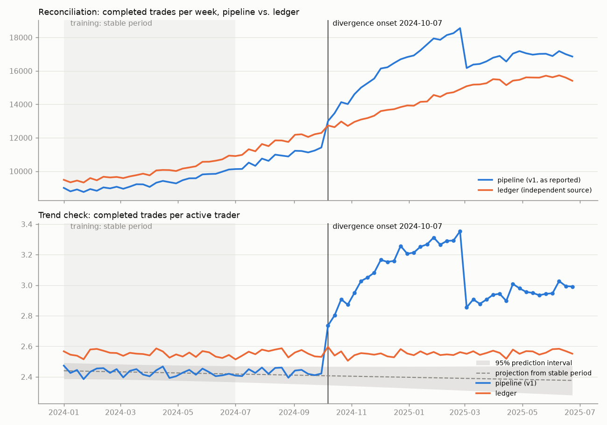

# The inherited pipeline: a country cut for "weekly active traders" without breaking it

```bash
pip install -r requirements.txt     # duckdb, pandas, statsmodels, matplotlib
python run.py                       # generate data → baseline → country cut → tests → measures → trend check
```

Runs in about 20 seconds. Every number below is from [output/report.txt](output/report.txt). The data is synthetic,
with ~18 months of trades (1.17M orders). Each issue was injected deliberately, and the run's scorecard
confirms the analysis recovers all of them (**15/15 exact**, including the week the trend check dates the
divergence to).

## TL;DR

- **Friday's country cut is ready and changes nothing.** It is the existing logic, exposed by country. For the
  week of 2025-06-23 the countries add up exactly to what the dashboard already reported: 5,636 active traders
  and 16,859 completed trades. Tests prove the cut matches v1 row for row over 11 weeks.
- **The metric is wrong, and the errors cancel out, which is why nobody noticed.** The device join inflates
  completed trades by 47%. Meanwhile, users with no active device and a new status code each remove trades.
  Against the clearing ledger, the net error is only +9.4% this week. It averaged −6.6% in H1 2024 and peaked at
  +24.6%.
- **History doesn't reproduce.** 77 of 78 past weeks give a different answer if rerun today, by up to +41.9%.
- **Nothing gets fixed before Friday.** A silent fix would break comparison with every past review. A proposed v2
  is written and tested against the ledger, and it ships only after the PM agrees the definitions.

**The approach in one sentence:** run two jobs. Job 1 delivers the cut on the unchanged definition and proves
it reconciles. Job 2 measures each bug separately and fixes them later as an announced, versioned change.

## 1. What I flagged, ranked by impact on the number

Measured for the latest week, 2025-06-23, unless noted ([output/measures.csv](output/measures.csv)).

| # | Issue | Measured impact | Direction |
|---|---|---|---|
| 1 | **Device join fans out trades.** Each trade is counted once per active device. `COUNT(DISTINCT)` protects `active_traders` but not `completed_trades` | **+47.3%** completed trades (5,417 extra rows). The jump started with the 2024-10-07 multi-device launch: +13.8% week over week | inflates |
| 2 | **No active device means invisible.** Web-only and uninstalled users drop from *both* columns | **952 traders (14.5%)** and 1,873 completed trades missing | deflates |
| 3 | **`is_active` is today's state, not the week's.** Rerunning history rewrites it | **77 of 78 weeks** don't reproduce. Active traders −5.9% to 0%; completed trades **0% to +41.9%** (devices added later fan out old trades) | both |
| 4 | **Undocumented status codes.** Code 5 appeared on 2025-03-03 (fractional shares) and is silently excluded | **2,094 fills/week missing**, a −12.9% week-over-week drop on launch | deflates |
| 5 | **The two columns use different definitions.** "Active" means *any* order, including cancelled or rejected; "completed" means 1 or 3 | **764 "active traders" (13.6%)** completed nothing | inflates traders |
| 6 | **Country is current, not at time of trade;** NULL countries form an easy-to-miss group | 161 trades moved to a different country in 2024-01-01 history. 168 traders have a NULL country this week | shifts |
| 7 | **Hygiene:** dates edited by hand, `created_at` timezone unstated, comma joins (one lost predicate means a cross join) | no measured impact. **Done right:** the half-open date range | — |

**Key observation:** the core query already does `GROUP BY u.country`. The country cut is a by-product of the
existing logic, so the fastest safe path is exposing it, not writing anything new.

**Why the total looked plausible** ([output/ledger_to_v1_walk.csv](output/ledger_to_v1_walk.csv); it sums exactly):

| Step | Trades |
|---|---|
| Ledger: filled orders (truth) | 15,409 |
| − completed trades of users with no active device (#2) | −1,873 |
| − status 5 fills v1 doesn't count (#4) | −2,094 |
| = one row per completed trade, v1's population | 11,442 |
| + extra rows from the device fan-out (#1) | +5,417 |
| **= v1 `completed_trades` (the dashboard)** | **16,859** |

## 2. The plan (this order is deliberate)

**Step 0: definitions first, with the PM. This doesn't block Friday.** Four questions:
- Does a cancelled or rejected order make someone an "active trader"?
- Must a trader have an active app device? (952 currently don't.)
- Which country: current, or at the time of the trade?
- Are status 3 (partial fill) and 5 (fractional fill) "completed"?

Friday uses the existing definition, labeled as such. The answers drive v2.

**Step 1: AI-assisted understanding and risk profiling** (see section 3 for how each output was verified).

**Step 2: freeze a baseline.** v1 as-is for the last 8 weeks by country goes to
[output/baseline_v1.csv](output/baseline_v1.csv). Every later run compares against it. The current run
reports "MATCHES".

**Step 3: build the country cut on the existing logic.** The query is
[sql/weekly_active_traders_by_country.sql](sql/weekly_active_traders_by_country.sql). It keeps the same joins,
filters and quirks. The only changes are ones that can't alter results:
- parameterized dates
- explicit `JOIN`s
- `IN (1, 3)`
- NULL shown as "Unknown"

*Rejected:* fixing the fan-out "while I'm in there". An unannounced change breaks comparison with every past
review, and Friday's slide would disagree with last week's.

| Week of 2025-06-23 | US | GB | DE | CA | BR | SG | AU | FR | Unknown | **Total** |
|---|---|---|---|---|---|---|---|---|---|---|
| Active traders | 2,423 | 776 | 566 | 505 | 369 | 356 | 281 | 212 | 148 | **5,636** |
| Completed trades | 7,210 | 2,279 | 1,678 | 1,505 | 1,117 | 1,049 | 842 | 720 | 459 | **16,859** |

**Step 4: prove nothing moved** ([tests/](tests/), 12/12 pass):
- *Known-answer fixture.* Maya has 2 active devices and 3 orders (1 cancelled). Leo trades but has no active
  device. v1 must return Maya with **4** completed trades and drop Leo; that pins today's behavior, bugs
  included. v2 must return **2** and include Leo. A trade at exactly the week boundary must fall in the next
  week.
- *Reconciliation:*
  - the cut equals v1 row for row over 11 weeks, including both launch weeks
  - countries sum to the total
  - the latest week equals the reported number
  - `users` is unique per user (otherwise the country sum breaks)
  - "Unknown" is a visible row

**Step 5: measure each bug separately, without touching production.** One query per issue
(`sql/measure_*.sql`), with the results in the table in section 1.

**Step 6: trend checks against data we trust.** See section 4.

**Step 7: tell the PM before Friday.** See section 5.

**Step 8: after Friday, ship v2 deliberately.** [sql/weekly_active_traders_v2.sql](sql/weekly_active_traders_v2.sql)
dedupes trades, never reads current device state, and uses an explicit status lookup
([seeds/trade_status.csv](seeds/trade_status.csv)). Country is taken as of week end, so it still sums.
- For 2025-06-23, v2 would report **6,039 active traders (+7.2%) and 15,409 completed trades (−8.6%)**, and
  it matches the ledger exactly in every week tested.
- Rollout:
  - run v1 and v2 side by side for 4+ weeks
  - restate history so trend charts don't show a fake jump
  - put a note on the dashboard
  - retire v1
- Its tests already run:
  - no fan-out (equals the ledger's distinct orders)
  - no unknown status codes
  - output unchanged when the devices table is wiped
  - a week-over-week alert above 10%

  That alert, run on the reported history, fires on exactly the two launch weeks (+13.8% on 2024-10-07,
  −12.9% on 2025-03-03). It would have caught both problems the week they started.
- Docs: the metric definition, the status code meanings, and a named owner.

## 3. How AI fits, and how each output is verified

| AI task | Rule | Verification here |
|---|---|---|
| Explain the 400 lines section by section; list every join, filter and assumption | Explanations are hypotheses | Each claimed bug has a measuring query and a fixture case (Maya: 4 vs. 2) |
| Infer status-code meanings | **Unverified until** a lookup table, the order-service code or an engineer confirms them | [measure_4](sql/measure_4_status_codes.sql) shows the evidence (e.g. code 5: first seen 2025-03-03, 100% fractional quantity, 100% in the ledger). The seed keeps `verified = false` |
| Profile the data and rank risks with estimated impact | An estimate is replaced by a direct query before it's quoted | Every number in section 1 comes from a query. None is an estimate |
| Draft the country cut and v2 | Accepted only if outputs match **row for row** on real data | `test_country_cut_matches_v1_row_for_row` (11 weeks). v2 is checked against the fixture and the ledger |
| Draft tests and docs | Reviewed by hand. The fixture answer is computed by hand, not by the code under test | `test_known_answer.py` documents the hand calculation |

Disclosure: this repo was itself built with an AI assistant, under exactly these rules. Each number in the
README was checked against `output/report.txt`.

## 4. Trend check: what it caught and what it can't



[trend_check.py](trend_check.py) trains OLS on the **stable period**, the 26 weeks before 2024-07-01, ahead of
any known product change. It projects forward with a 95% prediction interval and flags a divergence after 3
consecutive weeks outside it.
- **The detector is a ratio between metrics, completed trades per active trader**, not raw volume. A
  raw-volume trend fired on 49 weeks of the *ledger* as well, because the business grew faster than the stable
  period's trend; it can't tell growth from a bug. The ratio stayed inside the interval for the ledger in 50
  of 52 weeks.
- **It dates the divergence to 2024-10-07**, the multi-device sync launch, which is the clue to the root
  cause. The step down on 2025-03-03 (status 5) is visible in the chart.
- **Seasonality:** day-of-week patterns cancel out within a weekly metric. 26 training weeks can't identify
  annual seasonality, so the model doesn't pretend to.
- **The honest limitation:** a model learns whatever bias is in its training data. During the "stable" period
  the pipeline was already **6.6% below the ledger, steadily (sd 0.6 points)**. The trend check treats that as
  normal and can't see it. "Known-good" here means *stable*, not *correct*. Constant errors are caught only by
  reconciling with an independent source (top panel), so use both.
- **Forward-looking:** after v2 ships, the same comparison runs v1 vs. v2 vs. ledger for several weeks, before
  v1 is retired.

## 5. Draft message to the PM (sent before Friday)

> **Weekly active traders by country is ready** for the week of 6/23. It uses the exact definition behind
> the current dashboard: the countries add up to the 5,636 traders and 16,859 completed trades already
> reported, and I checked it row for row against the existing pipeline for 11 weeks.
>
> **Separately, I found issues in how the metric is calculated.** I've measured them but **changed nothing**,
> so Friday stays consistent with past reviews. The biggest:
> - completed trades are inflated ~47% because each trade is counted once per device
> - 952 traders last week (14.5%) who don't use the app weren't counted at all
> - fractional-share trades (since March) are excluded
>
> These partly cancel out. Against the trade ledger, the reported number is +9.4% this week, but it has been
> anywhere from −6.6% to +24.6%, so **much of the rise since October comes from the multi-device
> launch, not from trader behaviour.**
>
> I'd like to fix it as a planned change: agree four definitions with you, run old and new side by side, and
> restate history so the charts don't show a fake jump. Do you have 10 minutes this week? I'll bring the
> four questions.

## 6. With more time

- Read the rest of the 400 lines for further fan-out sources. Every join after this one inherits the
  inflated grain.
- Confirm the status codes with the order-service owner, and replace the seed with their table.
- Snapshot device state (or use SCD2) if any metric must use "had an app device during the week"; never use
  current state again.
- Restate history with v2, and annotate the dashboard on 2024-10-07 and 2025-03-03.
- Add these checks to scheduled CI: the fixture, row-count-after-join, and the week-over-week alert.
